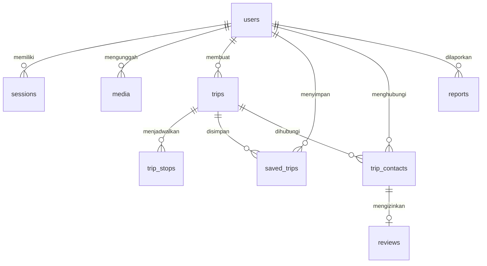

# Kontrak backend JastipHub

## Keputusan implementasi

Kode dibagi menjadi route HTTP di `src/routes.js`, logic aplikasi di `src/services/`, dan seluruh query/koneksi/migration di `src/database/`. Alurnya route → service → repository → MySQL. Folder tes dan dependensi testing tidak disertakan.

- Frontend React/Vite/React Router. Backend JavaScript ESM dengan Express 5. Database MySQL/InnoDB, koneksi pool dan parameter SQL melalui `mysql2`.
- Satu akun bisa membuat trip sekaligus menjadi penitip. Tidak ada pemilihan role saat daftar.
- Login dengan username dan password. Tidak ada email, SMTP, atau reset berbasis email.
- Saat daftar, kode pemulihan acak 128-bit ditampilkan sekali. Database hanya menyimpan hash kode. Reset membutuhkan username, kode tersebut, dan password baru; seluruh sesi dicabut dan kode diganti.
- Sesi server berlaku 14 hari. Cookie HTTP-only, SameSite=Lax secara default (dapat diatur melalui COOKIE_SAME_SITE), Secure pada production. Password memakai scrypt (N=32768, r=8, p=3, salt unik). Token sesi disimpan sebagai SHA-256.
- Request mutasi wajib menyertakan Origin aplikasi dan `X-Requested-With: JastipHub`. Jika sudah login, wajib `X-CSRF-Token` dari respons sesi/login.
- Respons publik tidak menyertakan nomor WhatsApp, hash password, hash recovery, atau data sesi. Nomor lengkap hanya pada profil sendiri dan link aksi kontak untuk pengguna login.

## Bentuk respons

Sukses: `{ "data": ... }`. Daftar publik/paginasi menambahkan `{ "meta": { "page", "pageSize", "total", "pages" } }`.

Kegagalan:

```json
{
  "error": {
    "code": "VALIDATION_ERROR",
    "message": "Tanggal pulang harus sama atau setelah tanggal berangkat.",
    "fields": { "end": "Tanggal pulang harus sama atau setelah tanggal berangkat." },
    "requestId": "uuid"
  }
}
```

Status: 200 berhasil, 201 dibuat, 400 JSON rusak, 401 belum login/kredensial salah, 403 tidak berhak/CSRF/origin tidak sesuai, 404 tidak tersedia, 409 konflik/duplikat/versi berubah, 413 terlalu besar, 422 validasi, 429 rate limit, 500 gangguan internal. Request ID juga ada di header. Rate limit mengirim header standar dan `Retry-After` jika terlampaui. Pesan kesalahan database internal tidak diberikan ke browser.

## Endpoint

Awalan seluruh endpoint `/api/v1`. `Auth` berarti membutuhkan sesi dan CSRF untuk mutasi. Semua input objek bersifat strict kecuali dinyatakan berbeda.

| Metode dan path | Akses | Input | Data sukses |
|---|---|---|---|
| `GET /health` | Publik | — | `{status,database}` setelah query database berhasil |
| `GET /auth/session` | Publik | — | `{user:null atau profil sendiri,csrfToken,demoEnabled}` |
| `POST /auth/register` | Publik | `{name,handle,password,phone}` | `{user,csrfToken,recoveryCode}` dan cookie; 201 |
| `POST /auth/login` | Publik | `{handle,password}` | `{user,csrfToken}` dan cookie |
| `POST /auth/demo` | Development | — | Sesi Aldo jika demo aktif dan sudah di-seed |
| `POST /auth/reset-password` | Publik | `{handle,recoveryCode,password}` | `{recoveryCode,message}`; kode pengganti, cookie dibersihkan |
| `POST /auth/logout` | Auth | — | `{loggedOut:true}`; sesi dicabut |
| `GET /me` | Auth | — | Profil sendiri, termasuk WhatsApp |
| `PATCH /me` | Auth | `{name,handle,phone,city,avatar}` | Profil sendiri terbaru |
| `GET /destinations` | Publik | — | `[{key,name,cover}]`, daftar bawaan + negara trip publik mendatang |
| `GET /trips` | Publik | query `q,country,date,sort,page,pageSize,ownerId` | Trip publik yang belum selesai dan meta pagination |
| `GET /trips/:id` | Publik/pemilik | ID | Detail publik; draft hanya pemilik |
| `GET /me/trips` | Auth | — | Semua trip sendiri, termasuk draft dan yang selesai |
| `GET /me/trips/:id` | Pemilik | ID | Detail editor; 404 bagi pengguna lain |
| `POST /trips` | Auth | Payload trip di bawah | Trip baru; retry ID sama mengembalikan hasil pertama |
| `PATCH /trips/:id` | Pemilik | Payload trip tanpa `id`, wajib `version` | Trip terbaru dengan versi bertambah |
| `GET /me/saved-trips` | Auth | — | Semua trip publik yang disimpan |
| `PUT /me/saved-trips/:id` | Auth | — | `{tripId,saved:true}`, idempotent |
| `DELETE /me/saved-trips/:id` | Auth | — | `{tripId,saved:false}`, idempotent |
| `GET /users/:id` | Publik | ID | `{id,name,handle,avatar,city,rating,count}` |
| `GET /users/:id/reviews` | Publik | query `page,pageSize` | `[{id,tripId,rating,text,createdAt,city,author:{id,name,avatar}}]` + meta |
| `POST /trips/:id/contact` | Auth | `{stopId?}` | `{tripId,url,recorded:true}` |
| `GET /me/contacts` | Auth | — | `[{trip,firstContactAt,lastContactAt,eligible,reviewed?,reason}]` |
| `GET /trips/:id/review-eligibility` | Auth | — | `{eligible,reviewed?,reason}` |
| `POST /trips/:id/reviews` | Auth | `{rating,text,acknowledged:true}` | `{id,tripId,rating,text,jastiper}`; 201 |
| `POST /reports` | Publik | `{targetId,reason,details?}` | `{id,status:"received"}`; 201 |
| `POST /uploads` | Auth | multipart `file`, `purpose:avatar atau cover` | `{id,url,purpose}`; 201 |

Daftar trip: `q` mencari kota, negara, nama/username jastiper, atau nama toko. Pencarian memperlakukan `%`/`_` sebagai karakter literal. Negara dinormalisasi memakai alias (Japan/Jepang, USA/Amerika Serikat, dst). `date` berada secara inklusif di antara tanggal berangkat/pulang. `sort` adalah `soon` (berangkat terdekat), `latest` (tanggal berangkat paling akhir, bukan tanggal pembuatan), atau `rating`. Default page=1, pageSize=12, maksimal 30. Urutan seri memakai ID agar pagination stabil.

## Payload trip dan aturan

```json
{
  "id": "uuid-klien-untuk-pembuatan",
  "city": "Tokyo",
  "country": "Jepang",
  "start": "2028-12-10",
  "end": "2028-12-15",
  "type": "percentage",
  "value": 8.5,
  "cover": null,
  "status": "published",
  "stops": [{"name":"Nintendo Tokyo","category":"Gaming","dayOffset":1}]
}
```

- Untuk update hapus `id` dan sertakan `version` dari pembacaan terakhir. Owner selalu dari sesi; input owner dari klien ditolak.
- Draft wajib negara/kota, tetapi tanggal, fee, toko boleh belum lengkap (`null`/array kosong).
- Publikasi wajib tanggal valid, end >= start, minimal satu toko, fee valid. Fee 0 diizinkan. Persentase 0–100 maksimal satu desimal; nominal rupiah bulat >=0. Maksimal 30 toko, nama unik tanpa membedakan kapital, dayOffset 0–366 dan tidak melewati tanggal pulang.
- Negara/kota maksimal 100 karakter, nama toko/kategori 150. Tanggal 2000–2100. Semua input divalidasi lagi di server.
- `cover:null` menggunakan cover otomatis sesuai negara. Cover custom harus URL media milik pemilik dengan purpose `cover`. Cover bawaan data demo hanya dapat dipertahankan pada record yang sama.
- Trip dan semua stop disimpan dalam transaksi. Versi lama menghasilkan `409 VERSION_CONFLICT`; tidak menimpa perubahan tab lain.
- Trip published tetap published saat disimpan. Tidak ada tombol penarikan publikasi pada scope frontend ini.
- Jika sudah ada kontak, tanggal perjalanan dikunci untuk menjaga riwayat/kelayakan ulasan. Buat trip baru untuk jadwal berbeda. Fee, toko, kota, dan cover masih dapat diedit.
- Respons trip menyediakan `person` publik, `stops` terstruktur, serta `stores/categories/days` untuk komponen tampilan. `cover` adalah gambar efektif, `customCover` adalah nilai tersimpan, `saved` sesuai pengguna aktif, dan `version` untuk editor.

## Kontak, ulasan, dan upload

Preview WhatsApp tidak mencatat kontak. Aksi Buka WhatsApp memvalidasi trip publik, menolak trip sendiri, mengambil nomor terbaru dari profil, menyimpan satu kontak per user/trip, lalu memberikan URL `wa.me` dengan pesan (termasuk toko jika dipilih). Klik berulang memperbarui waktu kontak terakhir. Browser membuka tab secara sinkron sebelum menunggu API agar tidak terkena popup blocker; jika API gagal tab ditutup, jika popup diblokir diberikan tautan lanjutan.

Ulasan memerlukan kontak, bukan trip sendiri, trip published, tanggal selesai sebelum hari ini Asia/Jakarta, rating 1–5, teks 1–1200 karakter, dan checkbox persetujuan. Maksimal satu ulasan per user/trip. Kelayakan dicek ulang dalam transaksi dengan lock trip; submit bersamaan tidak membuat ulasan ganda. Rating rata-rata dan jumlah ulasan dihitung dari review tersimpan, bukan angka contoh.

Laporan tamu diizinkan dengan `author_id=NULL`, dan rate limit. Pilihan alasan sesuai UI; “Alasan lainnya” wajib detail. Status awal `received`; belum ada dashboard moderator atau janji waktu penanganan.

Upload menerima JPG/PNG/WebP maksimal 5 MB dan 25 juta pixel. Isi file benar-benar didekode, animasi/format lain ditolak, metadata dibuang saat dikonversi WebP, orientasi diperbaiki, lalu dipotong sesuai avatar/cover. Nama file UUID dari server. Gambar disimpan di `UPLOAD_DIR`, referensi dan pemilik di `media`. File yang diunggah lalu dibatalkan belum memiliki pembersihan otomatis; operator dapat meninjau media yang tidak direferensikan sebelum menghapusnya. Jangan menjalankan penghapusan berdasarkan nama file dari pengguna.

## Tabel dan hubungan



Recovery hash berada pada `users` karena hanya satu kode aktif per akun. Tidak ada tabel email/token email. `schema_migrations` mencatat nama, checksum, dan waktu penerapan. Constraint unik menjaga username, simpanan, kontak, posisi/nama toko, dan ulasan. Timestamp disimpan UTC; tanggal perjalanan berupa DATE.

## Integrasi frontend

Setiap resource memiliki loading, empty, error, dan tombol retry. Pergantian filter membatalkan request lama. Input form tetap ada saat mutasi gagal. Tombol submit dinonaktifkan saat menunggu respons; pembuatan trip memakai UUID stabil untuk retry. Toast sukses hanya setelah server mengonfirmasi. Mutation menginvalidasi data yang perlu dibaca ulang. Sesi dipulihkan sebelum protected route memutuskan redirect, dan response 401 pada resource privat mengakhiri sesi frontend.

Aksi Simpan sebelum login dilanjutkan setelah autentikasi. Aksi Chat sebelum login kembali ke trip dan preview yang sesuai (termasuk toko). Modal, navigasi, scroll destinasi, show/hide password, pilihan bintang, kalkulasi contoh fee, tambah/hapus toko, dan pilihan foto sementara berjalan lokal; perubahan permanen dikirim saat submit.

## Batas deployment saat ini

Target awal satu instance Express dengan filesystem persistent. Rate limiter masih in-memory, bukan shared store lintas server. Login demo hanya development, data seed tidak untuk production. Belum ada pembayaran, pesanan, verifikasi transaksi WhatsApp, moderasi UI, atau integrasi object storage. Cloud database akan dikonfigurasi oleh pemilik proyek; koneksi provider tersebut perlu diuji setelah kredensial tersedia.
